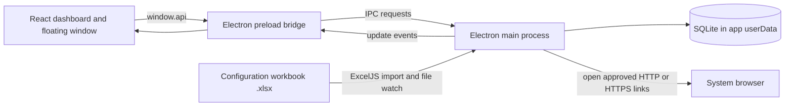
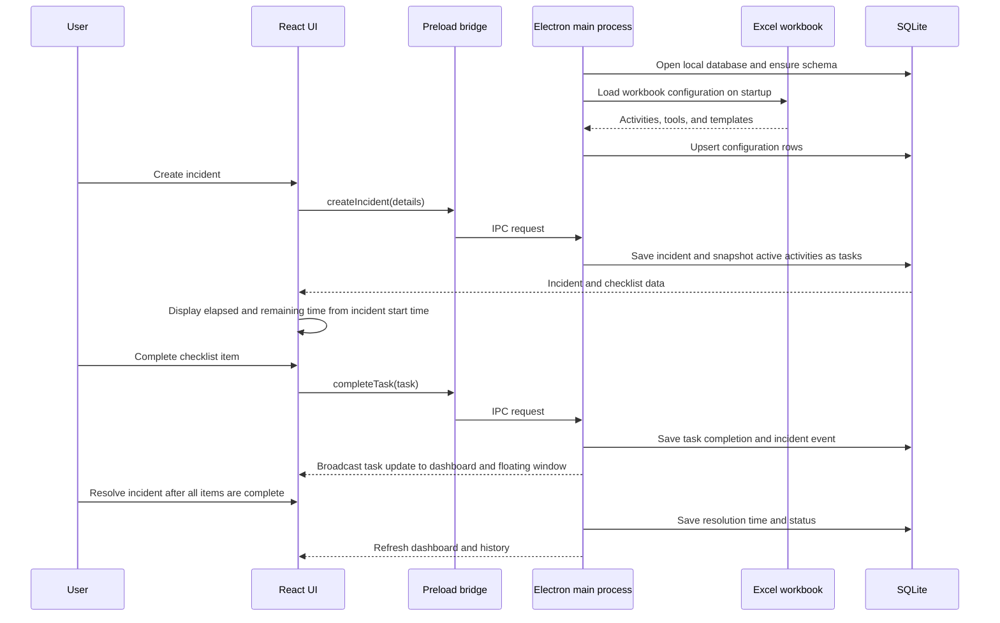

# Sev-1 Navigator

Sev-1 Navigator is a local-first desktop app for coordinating SEV-1 response. It provides incident timers, a response checklist, a small floating timer window, tool links, communication templates, and a history of the latest ten incidents.

Incident data is stored locally in SQLite. The Excel workbook supplies the configurable activities, tools, and communication templates. The app does not require a cloud service.

## Application architecture



### Main modules

| File or folder | Responsibility |
| --- | --- |
| `src/main/index.ts` | Owns the SQLite database, workbook import and reload watcher, incident rules, IPC handlers, notifications, and the main and floating Electron windows. |
| `src/preload/index.ts` | Exposes a limited `window.api` bridge to the UI. The renderer has no direct Node.js access. |
| `src/renderer/App.tsx` | Renders the dashboard, response checklist, floating timer, tool launcher, templates, incident history, and settings. |
| `src/renderer/main.tsx` | Mounts the React application into the renderer page. |
| `src/renderer/style.css` | Defines the dashboard and floating-window presentation. |
| `src/renderer/types.d.ts` | Declares the renderer's TypeScript API types. |
| `electron.vite.config.ts` | Configures separate Electron main, preload, and renderer builds. The native SQLite module stays external to Vite's bundle. |
| `SEV1-Command-Center-Configuration.xlsx` | Bundled starter configuration for activities, tools, and communication templates. |
| `build/icon.icns` | macOS application icon used by the packaged app. |
| `config/README.txt` | Short note about the editable workbook and sample tool URLs. |

### Incident program flow



When an incident is created, its checklist is copied from the currently active workbook activities. Later workbook changes affect new incidents; they do not rewrite tasks already attached to existing incidents. Completing all checklist items enables resolution. The app stores the resolution time and shows resolved incidents in history. It retains the latest ten incidents.

The workbook must have sheets named `Activities`, `Tools`, and `Communication Templates`, with the headers shown in the bundled example workbook. The active workbook is watched for edits and imported automatically after it is saved. The packaged workbook is copied into Electron's per-user application data folder on first launch. If you change workbook values in the source repository, rebuild the installer so the new workbook is bundled for new installations.

On macOS, the managed workbook is stored under `~/Library/Application Support/`; on Windows, it is under `%APPDATA%`. Edit the workbook in that app data folder and save it to trigger a reload. Keep the workbook sheet names, column headers, and existing IDs intact when editing it.

## Run from source

### Requirements

- macOS for the macOS app and installer builds
- Node.js 22.12 or later and npm (Node.js 22 LTS is recommended)
- Xcode Command Line Tools when a native dependency has to compile from source

The current Electron runtime requires Node.js 22.12 or later for development tooling. A clean `npm ci` was verified on Node.js 26.7.0 with the current SQLite dependency.

### Compile and run the app

```bash
git clone <repository-url>
cd Sev-1-Navigator
npm ci
npm audit
npm run typecheck
npm run build
npm run dev
```

`npm ci` installs the exact dependency versions from `package-lock.json`. `npm run typecheck` checks the TypeScript types, and `npm run build` compiles the Electron main process, preload, and React renderer into `out/`. `npm run dev` starts the desktop app against the local Vite development server.

If your shell has `ELECTRON_RUN_AS_NODE` set, unset it when starting Electron:

```bash
env -u ELECTRON_RUN_AS_NODE npm run dev
```

### Check a fresh clone before pushing

After pushing source changes, clone the GitHub repository into a new folder and repeat the compile and run steps above. Confirm the dashboard opens and the workbook, incident timer, checklist, and history behave as expected. The installer files are generated locally and do not come down with the clone because `release/` is Git-ignored.

## Build macOS installers

Run these commands on a Mac after installing dependencies:

```bash
npm run package -- --mac pkg --arm64
npm run package -- --mac pkg --x64
```

Each command compiles the app and packages one architecture. The installer files are written to `release/` with version and architecture in their names:

- `Sev-1 Navigator-<version>-arm64.pkg` for Apple Silicon Macs
- `Sev-1 Navigator-<version>-x64.pkg` for Intel Macs

Keep the installers out of Git commits. These packages are unsigned and not notarized, so macOS may show a security warning during installation. Do not tell recipients to bypass a warning unless they trust the installer source and their organization allows it.

## Sharing the app

### For people reviewing the code

Share the GitHub repository URL. Reviewers can follow the source setup steps above. The repo contains the application source, bundled workbook, icon, and packaging configuration. It does not contain `node_modules`, generated build output, or packaged installers.

### For end users who do not need the source code

Upload the two `.pkg` files to the approved organization shared folder and grant access to the intended users. Keep the architecture in each filename and add a short note with the app version and install instructions. The folder should contain the two installers for each release; keep source code and generated files out of it.

Share only the matching `.pkg` installer with each end user:

- `arm64` for Apple Silicon (M1, M2, M3, and later Apple Silicon Macs)
- `x64` for Intel Macs

They can check **Apple menu → About This Mac** to see whether their Mac has an Apple chip or an Intel processor. They then double-click the matching `.pkg` file and follow Apple's Installer. A `.pkg` installs the app directly, so it does not leave a mounted disk image on the desktop.

The installers are unsigned. macOS Gatekeeper may block an install or first launch. If the recipient trusts the source and their organization permits it, they can try the installer once, then use **System Settings → Privacy & Security → Open Anyway** to approve it. Managed Macs may require an administrator to approve it. See [Apple's Gatekeeper guidance](https://support.apple.com/en-us/102445).

## Where to store installer files

Do not commit generated installers to the normal Git history. These installers are about 110 MB each; GitHub rejects regular Git files larger than 100 MiB, and large generated binaries make every clone and repository history heavier. GitHub Releases are designed for distributing versioned binaries: each release asset must be smaller than 2 GiB. Attach the two architecture-specific `.pkg` files to a release and link to it from the repository. Public repository releases are public; private repository access follows the repository's access controls.

For internal-only distribution, an organization-managed shared folder is also a good option when it gives the intended users access control, ownership, and a familiar download location. Keep the source in GitHub and publish installers either as GitHub Release assets or in the approved organization folder. Git LFS can store large files, but it adds separate storage and download bandwidth quotas, so it is usually unnecessary for these versioned installer builds.

See GitHub's current guidance on [repository file limits](https://docs.github.com/en/repositories/working-with-files/managing-files/adding-a-file-to-a-repository), [release asset limits](https://docs.github.com/en/repositories/releasing-projects-on-github/about-releases), and [Git LFS quotas](https://docs.github.com/en/billing/concepts/product-billing/git-lfs).

## Local data and security

- Live incidents, task completion, application settings, and incident history are stored in a SQLite database in Electron's per-user application data folder.
- The workbook provides reusable response configuration; incident data is not written back into Excel.
- The dashboard, checklist, history, and templates work locally. Clicking a tool link opens that site in the system browser and may use the internet; the app does not send incident data to those sites.
- On macOS and Linux, the app restricts its local data directory and files to the current user. The files are not encrypted by the app, so use your operating system's disk encryption and account protections for sensitive incident data.
- The packaged renderer has a content security policy, is sandboxed, and cannot access Node.js directly. External navigation and pop-up windows are blocked inside the app.
- Replace sample `example.com` tool URLs with approved internal URLs before distribution.
- Do not put customer secrets, credentials, or sensitive tokens in the workbook or communication templates.
- The tool launcher only opens HTTP and HTTPS URLs in the system browser.
- Validate templates against your organization's approved incident communication process.
- Audit dependency advisories before release with `npm audit`.
